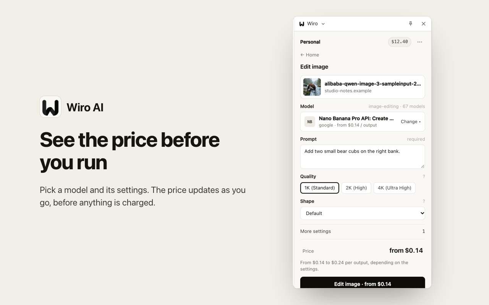
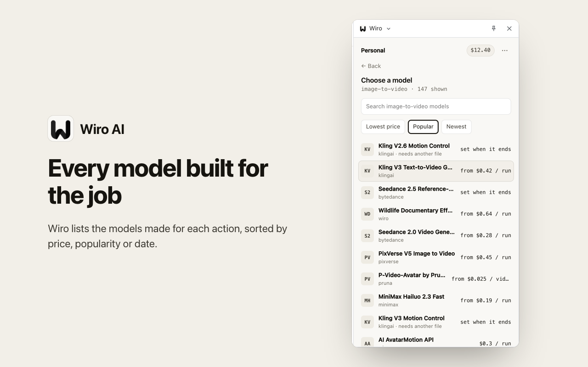

<div align="center">


# Wiro AI Extension for Safari on the Mac

Right-click any image, video, audio clip, text or page in Safari to run Wiro AI models: make a video, edit or upscale an image, restore a photo, read text aloud, transcribe, translate and more, with the price shown before every run.

[](./manifest.json) [](#build) [](./tsconfig.json) [](./LICENSE)

[Website](https://wiro.ai) · [Models](https://wiro.ai/models) · [Docs](https://wiro.ai/docs) · [Dashboard](https://wiro.ai/panel)


</div>

Wiro puts its AI models one right-click away. Pick what you want done with an image, a video, an audio clip, selected text or the page, choose a model from the live Wiro catalog, and the result comes back in the Wiro panel. You sign in with your Wiro account, runs are paid from your Wiro wallet, and the panel shows the price before you start.

<p align="center">
  
  
</p>
<p align="center">
  
  
</p>

## What you can do

| Right-click on | Actions |
| --- | --- |
| An image | make a video, edit with a prompt, upscale, restore an old photo, remove the background, blur faces, find objects, make a 3D model, ask about it, extract or translate its text, make a product ad, add effects, make a song from it, make it talk, try clothes on |
| A video | edit with a prompt, upscale, add music, ask about it |
| An audio clip | transcribe it, change the voice |
| Selected text | generate an image or a video, read it aloud, turn it into a song, translate it, summarize it |
| A page | turn it into a video with Wiro Studio, ask about it |

Each action lists the Wiro models made for it, so new models show up without an update. Sort them by price, popularity or date and pick one; the panel asks only for what that model needs.

## How Safari differs

- **No side panel.** The toolbar button opens the panel as a popup. A right-click opens the panel in a tab (a second click reuses that tab), because Safari's popup closes as soon as focus moves.
- **No identity API.** Apple's guidance is to start the OAuth flow in a new tab. The sign-in opens wiro.ai in a tab; wiro.ai sends the browser back to `https://wiro.ai/extension/callback`; the callback content script hands that address to the background, which checks it and trades the one-time code for tokens (PKCE, the verifier never leaves the extension), then closes the tab. The panel follows the sign-in through storage. Safari asks once to let the extension run on that wiro.ai page.
- **On the Mac.** Safari on iOS has no right-click menus for extensions.

## Build

Requirements: macOS with Xcode, Node.js 22 or newer and npm 10 or newer.

```bash
git clone --recurse-submodules https://github.com/wiroai/Wiro-Safari-Extension.git
cd Wiro-Safari-Extension
npm install
(cd core && npm install)
npm run typecheck
npm run build
npm run xcode
```

`npm run xcode` builds the app without signing, as a compile check. To run it, open `xcode/Wiro/Wiro.xcodeproj`, choose your team under Signing & Capabilities for both targets, and run the Wiro scheme. Then turn the extension on in Safari Settings > Extensions. A build signed only for development needs Develop > Allow Unsigned Extensions (show the Develop menu under Settings > Advanced).

After a core change: `git -C core pull origin main`, rebuild, and commit the new `core` pointer. After adding a file to `dist/`, add it to the extension target in Xcode as well.

## How it is built

The shared code (sign-in, MCP client, actions, model gateway, pricing and the panel UI) lives in [Wiro-Extension-Core](https://github.com/wiroai/Wiro-Extension-Core), included here as the `core/` submodule. This repo adds the Safari parts:

- `src/platform.ts`: storage and tabs for the core.
- `src/background.ts`: the service worker. It builds the right-click menus, opens the panel for a click and finishes the sign-in.
- `src/callback.ts`: a content script that runs only on `https://wiro.ai/extension/callback`.
- `src/panel.ts`, `public/panel.html`: the panel, shown as the toolbar popup and in a tab.
- `manifest.json`: Manifest V3 for Safari 16.4 and later.
- `xcode/Wiro/`: the macOS app that carries the extension, made with `xcrun safari-web-extension-converter`. Its extension target points at the files in `dist/`.

## Mac App Store

Shipping the app on the Mac App Store needs an Apple Developer Program membership. In Xcode, choose Product > Archive, then upload to App Store Connect. The bundle identifiers are `ai.wiro.safari` (app) and `ai.wiro.safari.Extension` (extension).

## Permissions

| Permission | Why |
| --- | --- |
| `contextMenus` | the Wiro entries in the right-click menu |
| `storage` | the sign-in tokens, the tray, run history and the last model picked per action |
| content script on `https://wiro.ai/extension/callback*` | finishing the sign-in |

The extension reads only what a right-click hands it (the item's address, the selected text or the page address) and sends it to Wiro when you start a run. See the [Wiro privacy policy](https://wiro.ai/agreement/privacy-policy).

## More from Wiro AI

| Repository | What it is |
| --- | --- |
| [Wiro-Chromium-Extension](https://github.com/wiroai/Wiro-Chromium-Extension) | Wiro AI extension for Chrome, Edge, Opera and Brave |
| [Wiro-Firefox-Extension](https://github.com/wiroai/Wiro-Firefox-Extension) | Wiro AI add-on for Firefox |
| [Wiro-Extension-Core](https://github.com/wiroai/Wiro-Extension-Core) | Shared core of the Wiro AI browser extensions |
| [Wiro-MCP](https://github.com/wiroai/Wiro-MCP) | Official MCP server for Wiro AI, [`@wiro-ai/wiro-mcp` on npm](https://www.npmjs.com/package/@wiro-ai/wiro-mcp) |
| [Wiro-Plugin](https://github.com/wiroai/Wiro-Plugin) | Wiro AI plugin for Cursor, Claude Code, Gemini CLI and Devin |
| [Wiro-LLM](https://github.com/wiroai/Wiro-LLM) | Wiro AI provider for the Vercel AI SDK |
| [Swift-QuickStart](https://github.com/wiroai/Swift-QuickStart) | WiroKit, the Wiro AI SDK for iOS |
| [Kotlin-QuickStart](https://github.com/wiroai/Kotlin-QuickStart) | WiroKit, the Wiro AI SDK for Android |
| [Dart-QuickStart](https://github.com/wiroai/Dart-QuickStart) | Wiro AI SDK for Dart and Flutter, [`wiro` on pub.dev](https://pub.dev/packages/wiro) |
| [ReactNative-QuickStart](https://github.com/wiroai/ReactNative-QuickStart) | Wiro AI SDK for React Native and Expo, [`@wiro-ai/wiro-react-native` on npm](https://www.npmjs.com/package/@wiro-ai/wiro-react-native) |
| [Swift-Realtime](https://github.com/wiroai/Swift-Realtime) | Realtime voice AI example for iOS |
| [Kotlin-Realtime](https://github.com/wiroai/Kotlin-Realtime) | Realtime voice AI example for Android |
| [Dart-Realtime](https://github.com/wiroai/Dart-Realtime) | Realtime voice AI example for Flutter |
| [ReactNative-Realtime](https://github.com/wiroai/ReactNative-Realtime) | Realtime voice AI example for React Native |
| [n8n-nodes-wiroai](https://github.com/wiroai/n8n-nodes-wiroai) | Wiro AI nodes for n8n, [`@wiro-ai/n8n-nodes-wiroai` on npm](https://www.npmjs.com/package/@wiro-ai/n8n-nodes-wiroai) |
| [Wiro-Docs](https://github.com/wiroai/Wiro-Docs) | Source of the Wiro AI API docs |

[Website](https://wiro.ai) · [Models](https://wiro.ai/models) · [Docs](https://wiro.ai/docs) · [X](https://x.com/wiroai)

## License

MIT, see [LICENSE](./LICENSE).
